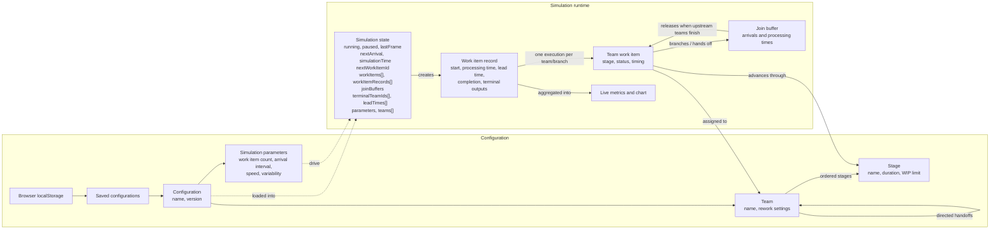

# Organization Flow Simulator

Click [here for latest deployed version](https://atje.github.io/organization_flow_simulator/).

## Data model

Each work item record represents one item entering the simulation. It can have multiple team work items
while work proceeds along parallel branches; a join buffer holds downstream work
until all upstream teams have completed.
